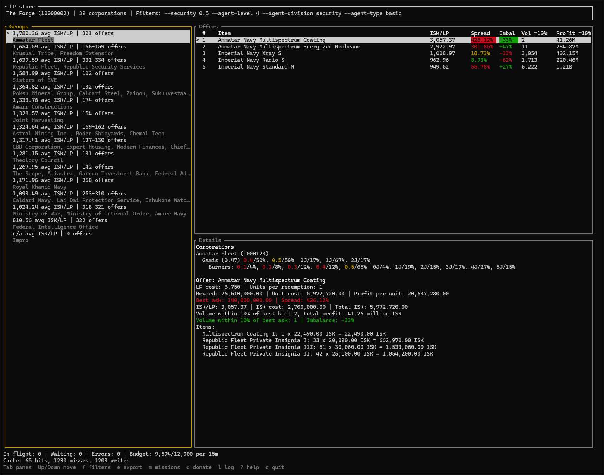
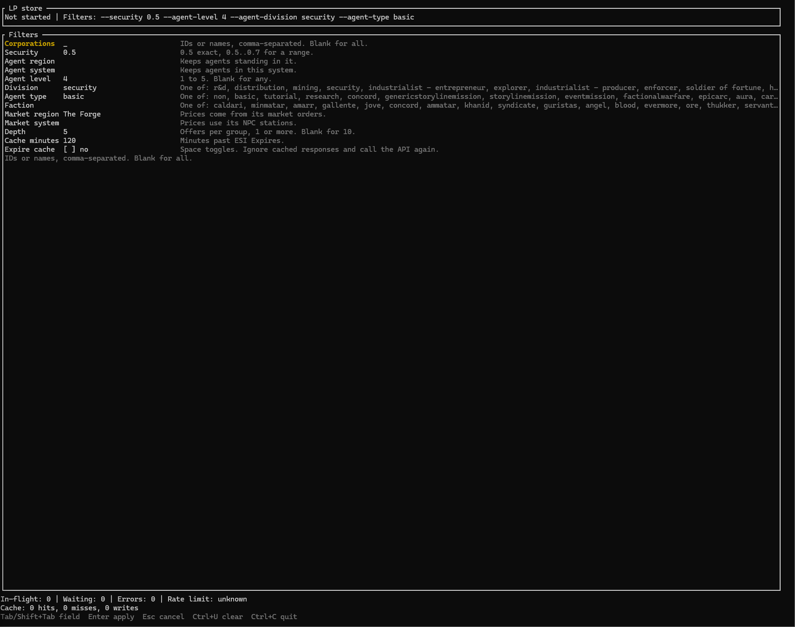
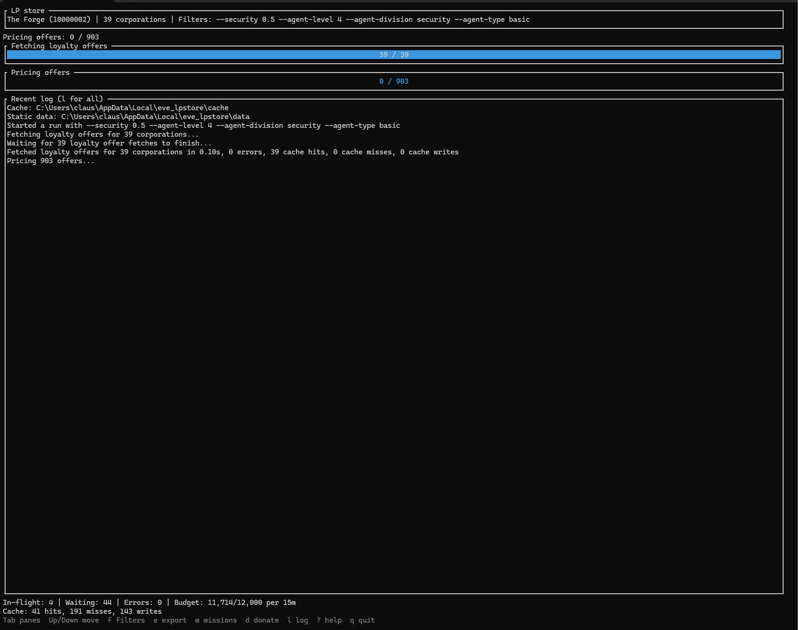

# eve_lpstore

Ranks EVE Online loyalty point (LP) store offers by ISK per LP, from live market data, in a
full-screen terminal view or as a text report.

Started out as a quick console prototype. Then I added a vibe coded UI. ESI layer is done by Claude as well.



## What it does

- Fetches the LP store of every NPC corporation from ESI, and prices each offer in one market
  region, The Forge unless `--region` says otherwise. The reward sells at the best buy order, and
  each required item is bought at the best sell order. ISK per LP is the reward times the units,
  less the ISK cost and the items, divided by the LP cost.
- Lists corporations whose top offers are the same as one group, best first by their average ISK
  per LP. `--depth` sets how many offers each group lists, 10 by default. `--sort` orders the
  groups by that average (`avg`), the ISK an LP budget realizes (`budget`), their best offer
  (`best`), or their profit within 10% of the best bid (`profit`).
- Works out what an LP budget, 1,000 LP unless `--lp-budget` says otherwise, realizes on each
  group's listed offers when the rewards are sold into the buy orders on the book, one whole
  redemption at a time, always the one with the best ISK per LP. A redemption uses up the buy
  orders it sells into, so the next one of the same reward sells lower. The choice is greedy and
  not guaranteed to be the best, items are always bought at the best sell price, and each group is
  worked out on its own.
- Filters corporations by their agents: system security, level, division, type, region, system,
  and faction. `--system` prices from one system's NPC stations only.
- Shows how far a price can be trusted: the bid/ask spread, the volume within 10% of the best bid,
  and how lopsided the order book is near the top.
- Leaves out offers by those markers: `--max-spread`, `--min-imbalance`, `--min-volume`, and
  `--min-profit`, with `--min-isk-per-lp` beside them. An offer missing a figure fails its filter,
  and a group then lists its top offers that pass and says how many its stores hide.
- In the full-screen view, `e` writes what is on screen to a `.csv` or `.json` file, and `m` shows
  where missions from the selected group's agents can take you. `f` edits the filters that decide
  what is fetched, and `v` the display filters: the depth, the LP budget, and the thresholds above,
  which re-arrange the groups without fetching again. `s` steps through the group sorts and `S`
  reverses the order. `x` excludes the selected offer wherever it is held, also in later
  sessions. `F` turns the thresholds and exclusions off and on; while they are off, the offers they
  would hide are shown dimmed, excluded ones struck through, and `x` on one restores it. The
  offers pane says how many offers are hidden. `o` steps the offers table through its sorts, by
  rank, spread, imbalance, volume and profit, and `O` reverses it; the `#` column keeps each
  offer's rank. `/` searches the corporation and item names and jumps to the next match, and `n`
  and `N` go to the next and previous one.

## What it does not do (yet)

- Search the offers: you still have to scroll down to SOE and verify that Lan is still there.

- (bug) There seem to be a bug in the ESI implementation where it calculates hisec routes wrong for some systems that have a trusec of <0.5 that should be rounded to 0.5, the tell is burners that show more than 10 jumps. I have notified Eve support but they did not want to forward  my bug report to the devs, since ESI  was not their desk.

## Install

Download an archive from the [Releases](https://github.com/colsen665/eve_lpstore/releases) page:

| Platform | Archive |
| --- | --- |
| Linux x86_64, any distribution (static) | `eve_lpstore-v<version>-x86_64-unknown-linux-musl.tar.gz` |
| Windows x86_64 | `eve_lpstore-v<version>-x86_64-pc-windows-msvc.zip` |

Each release lists the archives' SHA-256 sums in `SHA256SUMS`.

On other platforms, build it with a stable Rust toolchain:

```sh
cargo install --locked --git https://github.com/colsen665/eve_lpstore
```

## Use

```sh
eve_lpstore                       # full-screen view: asks for filters, then runs
eve_lpstore --lpstores            # the same report as text on standard output
eve_lpstore --lpstores --lpstore "Caldari Navy" --region Domain --depth 20
eve_lpstore --lpstores --security 0.5..0.7 --agent-level 4
eve_lpstore --lpstores --max-spread 20 --min-volume 1k --sort budget --lp-budget 1M
eve_lpstore --help                # every option, with examples
```

In the view, `?` lists the keys. The filters it applies are remembered for the next start.

## TUI

Inspired by BBG terminal

### Filters screen



### Loading ESI data



### Show results


## Files it keeps

`--verbose` prints where these are. On Linux:

- `~/.cache/eve_lpstore`: ESI responses, reused until they expire. `--cache-minutes` extends that,
  `--expire` ignores them, and `--clear-cache` deletes them.
- `~/.local/share/eve_lpstore`: names and locations from CCP's static data export. The first run
  downloads the whole export from developers.eveonline.com and keeps four extracted files. The view
  asks before downloading; `--lpstores` downloads it on its own.
- `~/.config/eve_lpstore/filters.json`: the filters and display filters the view last applied.
  The group sort is not kept.
- `~/.config/eve_lpstore/excluded_offers.json`: the offers excluded with `x` in the view, by offer
  ID, each with its item's name for reading. `--lpstores` does not read it.

Windows and macOS use their own cache, data, and config directories.

## ESI use

Only public ESI endpoints are used, so there is no login. The program caches responses, sends at
most `--max-inflight` requests at once (4 by default), and follows ESI's rate limits: after a 429 it
waits for the time ESI gives, and once less than a tenth of a budget is left it spaces its requests
and sends them one at a time. A full run with nothing cached spends about 7,000 of the market-order
budget of 12,000 tokens per 15 minutes, so a second such run straight after has to wait for the
budget and takes several times as long.

## Develop

```sh
cargo test
cargo clippy --all-targets -- -D warnings
cargo fmt --check
```

CI runs these on Linux, Windows, and macOS for every push and pull request.

## Release

1. Set the new `version` in `Cargo.toml`, run `cargo build` to update `Cargo.lock`, and commit.
2. Tag the commit and push the tag: `git tag v0.2.0 && git push origin v0.2.0`.

The release workflow checks that the tag matches `Cargo.toml`, builds the two archives above,
and publishes a GitHub Release with them, `SHA256SUMS`, and notes generated from the commits.

## License

Licensed under either of the [Apache License, Version 2.0](LICENSE-APACHE) or the
[MIT license](LICENSE-MIT), at your option.

Unless you explicitly state otherwise, any contribution intentionally submitted for inclusion in
the work by you, as defined in the Apache-2.0 license, shall be dual licensed as above, without any
additional terms or conditions.

## EVE Online

© 2014 CCP hf. All rights reserved. "EVE", "EVE Online", "CCP", and all related logos and images
are trademarks or registered trademarks of CCP hf.

eve_lpstore is not made by, affiliated with, or endorsed by CCP hf.
